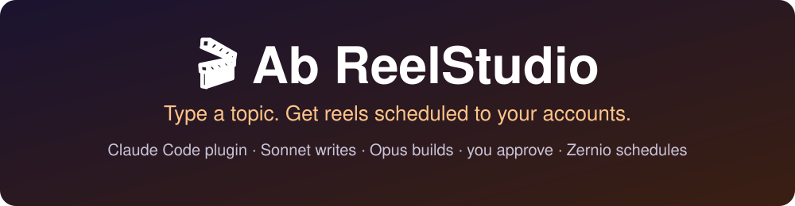
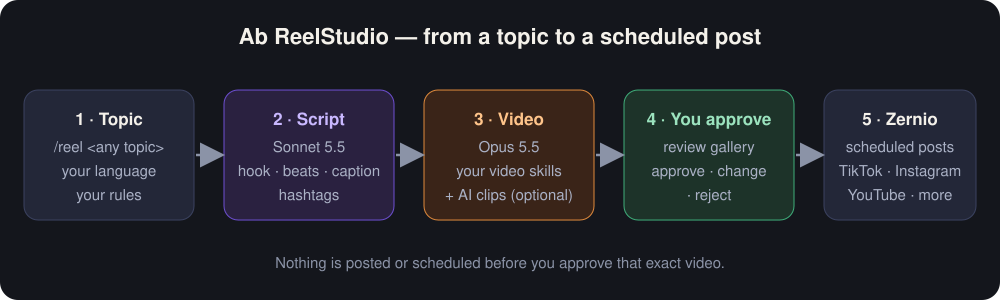
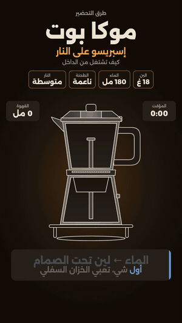
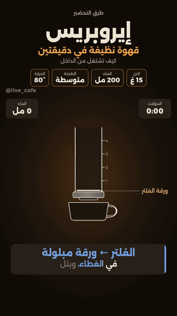
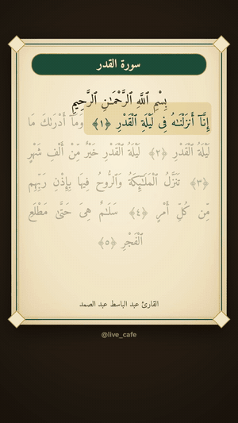
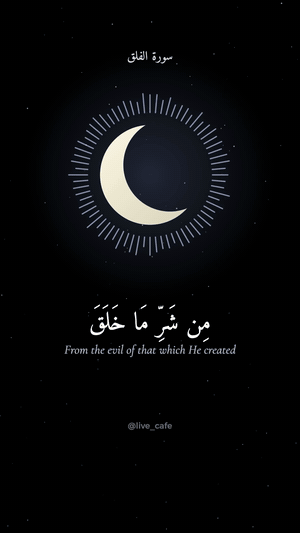
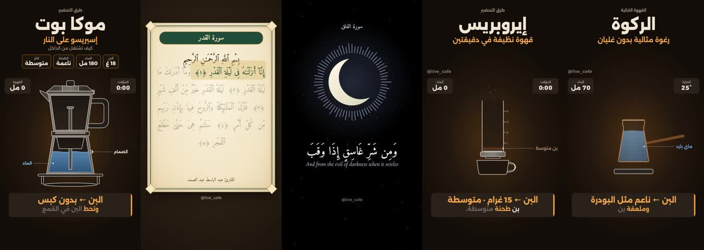

<p align="center"></p>

# 🎬 Ab ReelStudio — a plugin for Claude Code

**Type a topic. Get finished reels scheduled to your accounts.**

Sonnet writes the script, Opus builds the video with the video skills you have installed, you approve, then it is scheduled to TikTok, Instagram, YouTube and more through Zernio. **Nothing is posted without your approval.**

🇸🇦 [النسخة العربية](README.md) · Free · MIT · Any topic: coffee, science, Quran, FPV, anything

---

<p align="center"></p>

## 👀 Examples generated with the plugin

All made with the same steps: topic → script → video → approval → scheduling. (Short silent previews; the real videos are 30–45 s with voice.)

| ☕ Moka pot | ☕ AeroPress | 🌙 Mushaf | 🌙 Crescent |
|:--:|:--:|:--:|:--:|
|  |  |  |  |
| dark style, code-drawn | dark style, live counters | recitation, verse by verse | recitation + translation |

<p align="center"></p>

> 💡 The examples are coffee and Quran only because those are what was tried first. **The topic is yours**: science, tech, sport, cooking, anything.

## ⚠️ Before you start: you need a Zernio account

Scheduling goes through **[Zernio](https://zernio.com)**, a service that connects your accounts (TikTok, Instagram, YouTube…) and posts at the times you choose.

1. Create an account at [zernio.com](https://zernio.com).
2. Connect your social accounts in the Zernio dashboard.
3. Then `/reel-setup` links Claude Code to your account (sign-in through `/mcp`, **no keys**).

Without a Zernio account the plugin can still make videos, but it **cannot schedule them**.

---

## 🚀 Start here: 3 steps

| | Step | Command |
|---|---|---|
| 1️⃣ | Install the plugin (once) | terminal, below |
| 2️⃣ | Setup: connect Zernio, accounts, styles | `/reel-setup` |
| 3️⃣ | Make your first reel | `/reel specialty coffee` |

## 1️⃣ Install: once, about a minute

**You need Claude Code installed.** Open your terminal (**Terminal** on Mac, **PowerShell** on Windows) and run:

```
claude --version
```

Got a version number? Continue. Got `command not found: claude`? Install Claude Code first from [docs.claude.com/claude-code](https://docs.claude.com/en/docs/claude-code), then come back.

Paste the commands **one at a time** (command → Enter → wait):

```
claude plugin marketplace add abhjz/ab-reelstudio
```

```
claude plugin marketplace list
```

```
claude plugin install ab-reelstudio@ab-reelstudio
```

- ✅ **Check after the first command:** the second one (`marketplace list`) **must show `ab-reelstudio`**. If not, run the first command again (the connection may have dropped).
- 🔁 **Restart `claude`** after installing, or the commands will not appear in the session.
- 🏷️ **Two names, don't mix them up:** the add command takes the **repository** (`abhjz/ab-reelstudio`); the install command takes **plugin@marketplace** (`ab-reelstudio@ab-reelstudio`).

> 💡 **Best results:** run `claude` on **Opus 5.5**. The plugin pins Sonnet for scripts and Opus for videos by itself.

### 🔄 Turn on auto-update: don't skip this

So every new style and skill I add reaches you on its own:

In a normal terminal run `claude`, then:

```
/plugin  →  Marketplaces  →  ab-reelstudio  →  Enable auto-update
```

> ℹ️ `/plugin` is interactive and works in a **regular terminal only**, not inside the desktop app's Code tab.
> ⚠️ **Without this step you get no updates.** Auto-update is off by default for third-party marketplaces.
> 🔁 Want the latest now? `claude plugin update ab-reelstudio@ab-reelstudio`, then restart `claude`.

### 🌐 Or from claude.ai (no terminal)

Install once and it shows up on web, desktop and mobile, and keeps itself updated:

1. Open **claude.ai** → click your name → **Settings** → **Customize** → **Plugins** → **Add** → **Add marketplace**
2. Paste `abhjz/ab-reelstudio`, add it, then add **Ab ReelStudio**.
3. **Add** → **Manage marketplaces** → **⋮** → turn on **Sync automatically**.

> ☝️ Pick one way only (terminal **or** claude.ai) so you don't get duplicates.

## 2️⃣ Setup: `/reel-setup` (first time only)

Inside `claude`:

```
/reel-setup
```

It asks one question at a time:

1. **Connect Zernio.** The plugin ships the Zernio server. Type `/mcp`, pick **zernio**, sign in. **Never paste keys into the chat.**
2. **Accounts.** It lists the accounts connected to Zernio (TikTok, Instagram, YouTube…). You choose where videos go and describe each account's content.
3. **Your taste.** Language and dialect, tone, length, voice (your own / AI / none), music or not, sound effects or not, watermark, posting times.
4. **AI tools.** Do you have **Gemini Pro** (Google Flow, Nano Banana, AI Studio through your own Chrome) or **Higgsfield**? Or neither?
5. **Styles.** It checks what is installed, lists what is missing, and installs it with your OK (details below).

Everything you say stays **on your machine** (`.ab-reelstudio/profile.json`).

## 3️⃣ Make your first reel

```
/reel specialty coffee
```

| Step | Who | What happens |
|---|---|---|
| 📝 Script (optional) | **Sonnet** | writes it from a topic, checks yours, or picks the best moments from a podcast |
| 🎞️ Video | **Opus** | builds the video with the chosen style's skill and checks it (frozen frames, audio, cut-off text) |
| 👀 Review | you | a page with every video, script, caption and time slot; pick **Approve / Change / Reject** |
| 📅 Schedule | Zernio | only after you approve: uploads, validates, schedules at your times |

## 🧭 5 ways to start: the script is optional

| You have | Type | What happens |
|---|---|---|
| **Just a topic** | `/reel specialty coffee` | Sonnet writes the script → Opus builds the video |
| **Your own script** | `/reel --script "your text"` | It only checks it (length, hook, caption) and **never changes a word** without your OK |
| **A podcast or video link** | `/reel https://…` or `/reel --from video.mp4` | **No script**: rights check → download → transcript → Sonnet picks the best moments → Opus cuts them, adds captions and a hook |
| **A folder of clips** | `/reel --from ./my-clips` | **No script**: cuts to the beat, vertical |
| **Quran recitation** | `/reel --quran 93:1-11 --reciter <name>` | Text and audio from the **Tarteel** connector, verse by verse, **no music or effects** |

**Options for any path:** `--teaser` (3 seconds of the strongest moment up front) · `--ai` (AI clips) · `--voice own|tts|none` · `--no-checkpoint` (no approval before rendering) · `--count 3`.

> ⚠️ **Links:** the plugin always asks "do you own this content or have permission?". If not, it stops. It never bypasses protections or paywalls.

## 🩺 Full setup check: `/reel-doctor`

`/reel-setup` runs it for you and you can run it any time. One table of everything the plugin can use, with fixes offered (only with your OK):

| Item | What it checks |
|---|---|
| **Zernio** | connection and accounts (required for scheduling) |
| **Claude in Chrome** + **Gemini Pro** | Google Flow (Veo), Nano Banana, AI Studio voice |
| **Higgsfield** | optional |
| **Tarteel** | for Quran reels |
| Local tools | ffmpeg · Node · Python · pillow · yt-dlp · Whisper |
| Styles | HyperFrames · Remotion · Lemo-Opuscar · onetake · Clawd |
| Podcast engine | `majed-video` (MIT) for cutting podcasts with Arabic captions and hooks |

## 🗣️ What you can type

| You want | Type |
|---|---|
| A reel on a topic | `/reel causes of insomnia` |
| Several reels | `/reel sleep myths --count 3` |
| A specific style | `/reel gravity --style motion-graphics` |
| For one account | `/reel coffee --account main` |
| Surprise me | `/reel surprise me` |
| From a podcast | `/reel https://…` |
| Your own script | `/reel --script "…"` |
| Change settings | `/reel-setup` |
| Install styles | `/reel-install-styles` |
| Check everything | `/reel-doctor` |
| Quran | `/reel --quran 94 --reciter <name>` |

## 🧩 What's inside the plugin

**The plugin itself** (made by us, MIT):

| Type | Name | What it does |
|---|---|---|
| 🤖 Agent | `script-writer` (Sonnet 5.5) | writes the script: hook, beats, narration, caption, hashtags |
| 🤖 Agent | `video-producer` (Opus 5.5) | builds the video with the style's skill and checks it |
| 🛠️ Skill | `reel-setup` | setup: Zernio, accounts, taste, rules |
| 🛠️ Skill | `reel-pipeline` | detects the input type and runs the steps in order |
| 🛠️ Skill | `quran-reels` | verse-by-verse recitation from Tarteel, no music |
| 🛠️ Skill | `reel-doctor` | checks every setting and fixes it with your OK |
| 🛠️ Skill | `source-reels` | reels from a podcast, video or folder of clips, no script |
| 🛠️ Skill | `video-styles` | the style catalog and when to pick each |
| 🛠️ Skill | `install-styles` | checks and installs video skills from their sources |
| 🛠️ Skill | `ai-generators` | Google Flow / Nano Banana / AI Studio / Higgsfield |
| 🛠️ Skill | `review-gallery` | review page: approve / change / reject |
| 🛠️ Skill | `schedule-posts` | uploads, validates, schedules on Zernio |
| ⌨️ Commands | `/reel` · `/reel-setup` · `/reel-install-styles` · `/reel-doctor` | |
| 🔌 Connection | Zernio MCP server | `https://mcp.zernio.com/mcp` |

## 🎨 Styles and third-party skills

**A style is how the video gets drawn.** The plugin doesn't draw by itself; it drives skills made by other people that you install. **These skills are not ours.** Each has its own author and licence. The plugin **installs them from their official source** after showing you the licence (`/reel-install-styles`) and never copies their code.

| Style | Skill / source | Good for | Licence |
|---|---|---|---|
| ✨ **Motion graphics** (default) | [HyperFrames](https://github.com/heygen-com/hyperframes) by HeyGen | explainers, steps, numbers, captions, any topic | Apache-2.0 ✅ |
| ⚛️ **React-coded** | [Remotion skills](https://github.com/remotion-dev/skills) | data-driven videos and series | companies may need a paid licence ⚠️ |
| 🎞️ **Cinematic film** | [Lemo-Opuscar](https://github.com/lemomo-ai/lemo-opuscar) by LemoLab | stories, documentary, art styles (oil, watercolor, ukiyo-e); slow and token-heavy | demo films CC BY 4.0 |
| 🎥 **One take** | [onetake](https://github.com/feitangyuan/onetake) | teasers and launches from screenshots | **PolyForm Noncommercial: not for monetized accounts** ⛔ |
| 🖌️ **Brush animation** | [Clawd / ClaudeAnimationBase](https://github.com/JohnHeibel/ClaudeAnimationBase) | stories with a cartoon character | MIT |
| 🎙️ **Podcast engine** | [majed-video](https://github.com/majedphotos/video-ad-editor) by majedphotos | cutting podcasts and interviews with Arabic captions and hook cards | MIT |
| 🎬 **Cut from your footage** | any editing skill you have, or ffmpeg | podcasts, interviews, clips you own | — |
| 🛟 **Fallback** | ffmpeg | when nothing is installed | — |

**How does it choose?** Numbers/steps/explainers → motion graphics · story and mood → cinematic · your footage → cut. Force one with `/reel topic --style motion-graphics`. Choose "rotate" in setup and it changes style on every video.

### 🤖 AI generation tools (optional)

Setup asks: do you have **Gemini Pro**? **Higgsfield**?

| Tool | What it does | How |
|---|---|---|
| **Google Flow** (Veo) | short 8 s clips for hooks or B-roll | through your own Chrome, you sign in |
| **Nano Banana** | images and objects | same |
| **AI Studio** | narration in your dialect | same |
| **Higgsfield** | video, images, audio | through the Higgsfield connector (`/mcp`) |

No API keys are used, it never clicks Upgrade, and it stops when your quota runs out.

## 🧰 If something goes wrong

- **No `/reel` commands?** Restart `claude` and check that `claude plugin list` shows `ab-reelstudio`.
- **`Failed to add marketplace`?** Don't continue. Run `claude plugin marketplace list`; if `ab-reelstudio` is missing, run the add command again.
- **Zernio not working?** Type `/mcp` and make sure **zernio** is connected. If you see "Couldn't reach", remove it and add it again.
- **Want the latest version now?** `claude plugin update ab-reelstudio@ab-reelstudio`
- **Want to remove it?** `claude plugin uninstall ab-reelstudio@ab-reelstudio`
- ☝️ **Install it one way only** so you don't get duplicates.

## 🔒 Requirements and privacy

**Requirements:** Claude Code · **a Zernio account (required for scheduling)** · Node 22+ · ffmpeg · at least one style skill (`/reel-install-styles` installs them).

**Privacy:** your settings, account ids and videos stay in your project folder (`.ab-reelstudio/` and `ab-reelstudio-runs/`, both git-ignored). Nothing personal is in this repo. Nothing is posted or scheduled without your approval of **that video**.

## 📜 License

MIT: use, modify and share freely. Style skills have their own licences.
