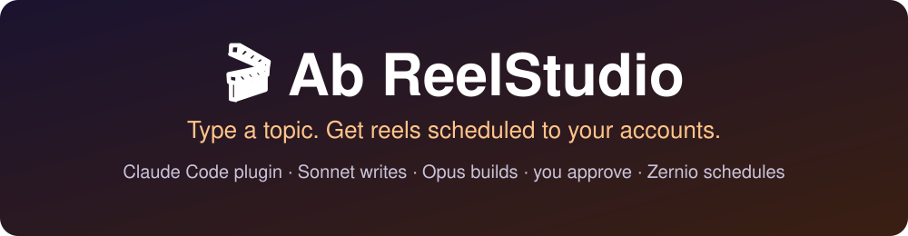
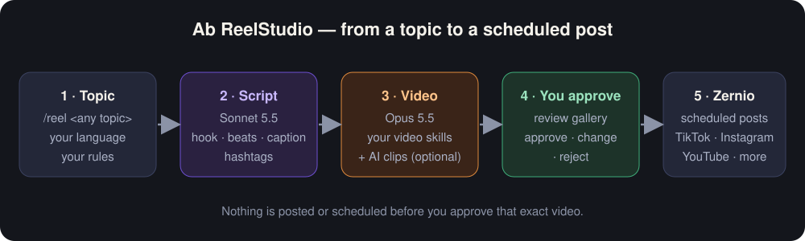
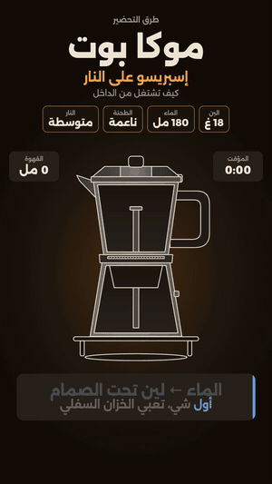
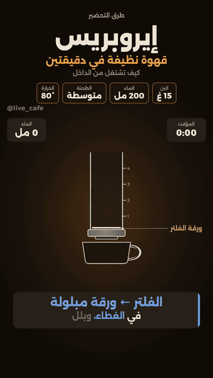
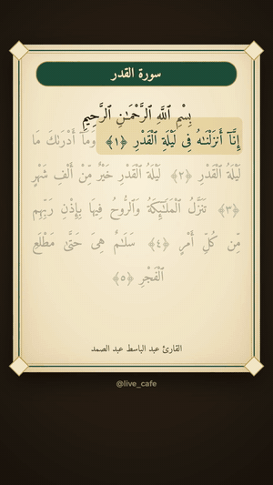
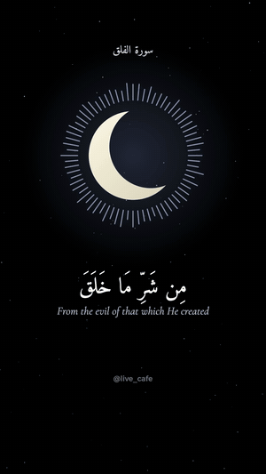
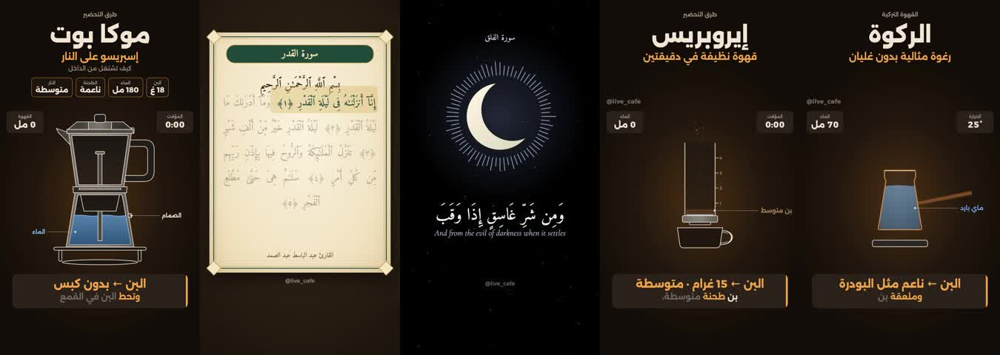

<div dir="rtl">

<p align="center"></p>

# 🎬 Ab ReelStudio — بلقن لـ Claude Code

**اكتب الموضوع… وتستلم ريلات جاهزة تنجدول على حساباتك.**

كلود سونيت يكتب السكربت، وأوبس يسوي الفيديو بالسكلات اللي عندك، وانت توافق، وبعدها ينجدول على تيك توك وانستقرام ويوتيوب عن طريق Zernio. **ما ينشر شي بدون موافقتك.**

🇬🇧 [English version](README.en.md) · مجاني · MIT · الموضوع لك: قهوة، علوم، قرآن، FPV، أي شي

---

<p align="center"></p>

## 👀 أمثلة من فيديوهات طلعت بالبلقن

كلها طلعت بنفس الخطوات: موضوع ← سكربت ← فيديو ← موافقة ← جدولة. (مقاطع قصيرة بدون صوت، والفيديوهات الأصلية 30–45 ثانية بصوت.)

| ☕ موكا بوت | ☕ إيروبريس | 🌙 مصحف | 🌙 هلال |
|:--:|:--:|:--:|:--:|
|  |  |  |  |
| ستايل غامق، رسم بالكود | ستايل غامق، عدّادات حيّة | تلاوة + آية بآية | تلاوة + ترجمة |

<p align="center"></p>

> 💡 الأمثلة قهوة وقرآن بس لأنها اللي جرّبناها. **الموضوع لك** — علوم، تقنية، رياضة، طبخ، أي شي.

## ⚠️ قبل لا تبدأ — لازم حساب Zernio

البلقن ينجدول عن طريق **[Zernio](https://zernio.com)** — خدمة تربط حساباتك (تيك توك، انستقرام، يوتيوب…) وتنشر بالوقت اللي تحدده.

1. سوّ حساب على [zernio.com](https://zernio.com).
2. اربط حساباتك الاجتماعية من لوحة Zernio.
3. بعدها `/reel-setup` يربط Claude Code بحسابك (تسجيل دخول من `/mcp`، **بدون مفاتيح**).

بدون حساب Zernio يقدر البلقن يسوي الفيديوهات، بس **ما يقدر يجدولها**.

---

## 🚀 ابدأ هنا — 3 خطوات

| | الخطوة | الأمر |
|---|---|---|
| 1️⃣ | ثبّت البلقن (مرة وحدة) | من الطرفية — تحت |
| 2️⃣ | الإعداد: ربط Zernio + حساباتك + ستايلاتك | `/reel-setup` |
| 3️⃣ | سوّ أول ريل | `/reel قهوة مختصة` |

## 1️⃣ ثبّت البلقن — مرة وحدة بس (دقيقة)

**تحتاج Claude Code منصّب.** افتح الطرفية — **Terminal** بالماك أو **PowerShell** بالويندوز — واكتب:

```
claude --version
```

طلع لك رقم نسخة؟ كمّل. طلع `command not found: claude`؟ نصّب Claude Code أول من [docs.claude.com/claude-code](https://docs.claude.com/en/docs/claude-code) وارجع.

الصق الأوامر **واحد واحد** (الأمر ← Enter ← انتظر):

```
claude plugin marketplace add abhjz/ab-reelstudio
```

```
claude plugin marketplace list
```

```
claude plugin install ab-reelstudio@ab-reelstudio
```

- ✅ **تحقق بعد الأمر الأول:** الأمر الثاني (`marketplace list`) **لازم يظهر فيه `ab-reelstudio`**. ما ظهر؟ أعد الأمر الأول (يمكن الاتصال تقطّع).
- 🔁 **أعد تشغيل `claude`** بعد التثبيت، وإلا ما تظهر الأوامر بالجلسة.
- 🏷️ **اسمين لا تتلخبط فيهم:** أمر الإضافة ياخذ اسم **المستودع** (`abhjz/ab-reelstudio`)، وأمر التنصيب ياخذ **البلقن@المتجر** (`ab-reelstudio@ab-reelstudio`).

> 💡 **للنتيجة الأقوى:** شغّل `claude` على **Opus 5.5** (البلقن يثبّت سونيت للسكربت وأوبس للفيديو بروحه).

**تحديث تلقائي:** بالطرفية العادية اكتب `claude` ← Enter، وبعدين:

```
/plugin  →  Marketplaces  →  ab-reelstudio  →  Enable auto-update
```

> ℹ️ أمر `/plugin` تفاعلي ويشتغل **بالطرفية العادية بس** — مو داخل تبويب Code بتطبيق الديسكتوب.

## 2️⃣ الإعداد — `/reel-setup` (أول مرة بس)

اكتب داخل `claude`:

```
/reel-setup
```

يسألك سؤال سؤال، وانت تجاوب:

1. **ربط Zernio** — البلقن مجهّز سيرفر Zernio. اكتب `/mcp` ← اختر **zernio** ← سجّل دخول بحسابك. **ما تلصق مفاتيح بالشات.**
2. **حساباتك** — يعرض لك الحسابات المربوطة بـ Zernio (تيك توك، انستقرام، يوتيوب…) وتختار وين ينزل الفيديو، وتكتب لكل حساب شنو محتواه.
3. **ذوقك** — اللغة واللهجة، النبرة، الطول، الصوت (صوتك / ذكاء اصطناعي / بلا صوت)، موسيقى أو لا، مؤثرات أو لا، واترمارك، وأوقات النشر.
4. **أدوات الذكاء الاصطناعي** — عندك **Gemini Pro**؟ (Google Flow وNano Banana وAI Studio عن طريق كروم حقك) أو **Higgsfield**؟ أو ولا شي؟
5. **الستايلات** — يفحص شنو منصّب ويعرض لك الناقص ويثبّته بإذنك (التفاصيل تحت).

كل اللي تقوله يتحفظ **عندك بالجهاز** (`.ab-reelstudio/profile.json`) وما يطلع لأي مكان.

## 3️⃣ سوّ أول ريل

```
/reel قهوة مختصة
```

يصير جذي:

| الخطوة | مين | شنو يسوي |
|---|---|---|
| 📝 السكربت | **سونيت** | هوك + مشاهد + كلام + كابشن + هاشتاقات بلهجتك |
| 🎞️ الفيديو | **أوبس** | يبني الفيديو بسكل الستايل المختار ويفحصه (تجمّد، صوت، نص مقصوص) |
| 👀 المراجعة | انت | صفحة تشوف فيها كل فيديو + سكربته + الكابشن + الوقت، وتختار: **موافق / عدّل / ارفض** |
| 📅 الجدولة | Zernio | بعد موافقتك بس: يرفع، يتحقق، وينجدول بأوقاتك |

## 🗣️ شنو تقدر تكتب

| تبي | اكتب |
|---|---|
| ريل عن موضوع | `/reel أسباب الأرق` |
| كذا ريل | `/reel خرافات النوم --count 3` |
| ستايل معين | `/reel الجاذبية --style motion-graphics` |
| لحساب معين | `/reel قهوة --account main` |
| فاجئني | `/reel فاجئني` |
| تغيّر إعداداتك | `/reel-setup` |
| تثبّت ستايلات | `/reel-install-styles` |

## 🧩 شنو داخل البلقن

**البلقن نفسه** (من سوّه فريقك، MIT):

| النوع | الاسم | شنو يسوي |
|---|---|---|
| 🤖 وكيل | `script-writer` (سونيت 5.5) | يكتب السكربت: هوك، مشاهد، كلام، كابشن، هاشتاقات |
| 🤖 وكيل | `video-producer` (أوبس 5.5) | يسوي الفيديو بسكل الستايل ويفحصه |
| 🛠️ سكل | `reel-setup` | الإعداد: Zernio، الحسابات، الذوق، القواعد |
| 🛠️ سكل | `reel-pipeline` | يدير كل الخطوات بالترتيب |
| 🛠️ سكل | `video-styles` | قائمة الستايلات ومتى يختار كل وحد |
| 🛠️ سكل | `install-styles` | يفحص ويثبّت سكلات الفيديو من مصادرها |
| 🛠️ سكل | `ai-generators` | Google Flow / Nano Banana / AI Studio / Higgsfield |
| 🛠️ سكل | `review-gallery` | صفحة المراجعة: موافق / عدّل / ارفض |
| 🛠️ سكل | `schedule-posts` | يرفع ويتحقق وينجدول على Zernio |
| ⌨️ أوامر | `/reel` · `/reel-setup` · `/reel-install-styles` | |
| 🔌 اتصال | سيرفر Zernio MCP | `https://mcp.zernio.com/mcp` |

## 🎨 الستايلات وسكلات الطرف الثالث

**الستايل = طريقة رسم الفيديو.** البلقن ما يبني الرسم بنفسه؛ يستخدم سكلات ناس ثانيين تثبّتها انت. **هالسكلات مو من صنعنا** — كل وحد له صاحب ورخصة، والبلقن **يثبّتها من مصدرها الرسمي** بعد ما يوريك الرخصة (`/reel-install-styles`)، وما ينسخ كودها.

| الستايل | السكل / المصدر | يصلح لـ | الرخصة |
|---|---|---|---|
| ✨ **موشن جرافيكس** (الافتراضي) | [HyperFrames](https://github.com/heygen-com/hyperframes) من HeyGen | شروحات، خطوات، أرقام، كابشن، أي موضوع | Apache-2.0 ✅ |
| ⚛️ **ريأكت كود** | [Remotion skills](https://github.com/remotion-dev/skills) | فيديوهات بيانات ومسلسلات | الشركات قد تحتاج رخصة مدفوعة ⚠️ |
| 🎞️ **فيلم سينمائي** | [Lemo-Opuscar](https://github.com/lemomo-ai/lemo-opuscar) من LemoLab | قصص، وثائقي، ستايلات فنية (زيت، مائي، أوكيو-إي) — بطيء وياكل توكنز | الأفلام التجريبية CC BY 4.0 |
| 🎥 **لقطة وحدة** | [onetake](https://github.com/feitangyuan/onetake) | تيزر وإطلاق منتج من لقطات شاشة | **PolyForm Noncommercial — مو للحسابات الربحية** ⛔ |
| 🖌️ **رسوم متحركة بفرشاة** | [Clawd / ClaudeAnimationBase](https://github.com/JohnHeibel/ClaudeAnimationBase) | قصص بشخصية كرتونية | MIT |
| 🎬 **قص من لقطاتك** | أي سكل مونتاج عندك أو ffmpeg | بودكاست ومقابلات ومقاطع تملك حقوقها | — |
| 🛟 **احتياطي** | ffmpeg | لو ما فيه شي منصّب | — |

**كيف يختار؟** رقم/خطوات/شرح ← موشن جرافيكس · قصة وإحساس ← فيلم سينمائي · لقطاتك ← قص. وتقدر تثبّت ستايل معين: `/reel موضوع --style motion-graphics`. وإذا اخترت «دوّر» يغيّر الستايل بكل فيديو.

### 🤖 أدوات الذكاء الاصطناعي (اختيارية)

الإعداد يسألك: عندك **Gemini Pro**؟ **Higgsfield**؟

| الأداة | شنو تسوي | كيف |
|---|---|---|
| **Google Flow** (Veo) | مقاطع قصيرة 8 ثواني للهوك أو الخلفية | عن طريق كروم حقك — تسجّل دخول انت |
| **Nano Banana** | صور وأغراض | نفسه |
| **AI Studio** | تعليق صوتي بلهجتك | نفسه |
| **Higgsfield** | فيديو وصور وصوت | عن طريق موصل Higgsfield (`/mcp`) |

ما يستخدم مفاتيح API، وما يضغط Upgrade، ويوقف لو خلصت الحصة.

## 🧰 لو صار شي

- **ما ظهرت الأوامر `/reel`؟** أعد تشغيل `claude`، وتأكد `claude plugin list` يطلع فيه `ab-reelstudio`.
- **`Failed to add marketplace`؟** لا تكمّل. شغّل `claude plugin marketplace list` — لو `ab-reelstudio` ما يظهر، أعد أمر الإضافة.
- **Zernio ما اشتغل؟** اكتب `/mcp` وتأكد إن **zernio** متصل. ظهر «Couldn't reach»؟ شيله وأضفه من جديد.
- **تبي آخر نسخة الحين؟** `claude plugin update ab-reelstudio@ab-reelstudio`
- **تبي تشيله؟** `claude plugin uninstall ab-reelstudio@ab-reelstudio`
- ☝️ **ثبّته بطريقة وحدة بس** عشان ما يتكرر عندك.

## 🔒 المتطلبات والخصوصية

**المتطلبات:** Claude Code · **حساب Zernio (إلزامي للجدولة)** · Node 22+ · ffmpeg · سكل ستايل واحد على الأقل (يثبّته `/reel-install-styles`).

**الخصوصية:** إعداداتك ومعرّفات حساباتك والفيديوهات كلها بمجلد مشروعك (`.ab-reelstudio/` و`ab-reelstudio-runs/`، وكلها خارج git). ما في شي شخصي بالمستودع. البلقن ما ينشر ولا يجدول شي بدون موافقتك على **الفيديو نفسه**.

## 📜 الرخصة

MIT — استخدمه وعدّله ووزّعه بحرية. سكلات الستايلات لها رخصها الخاصة.

</div>
